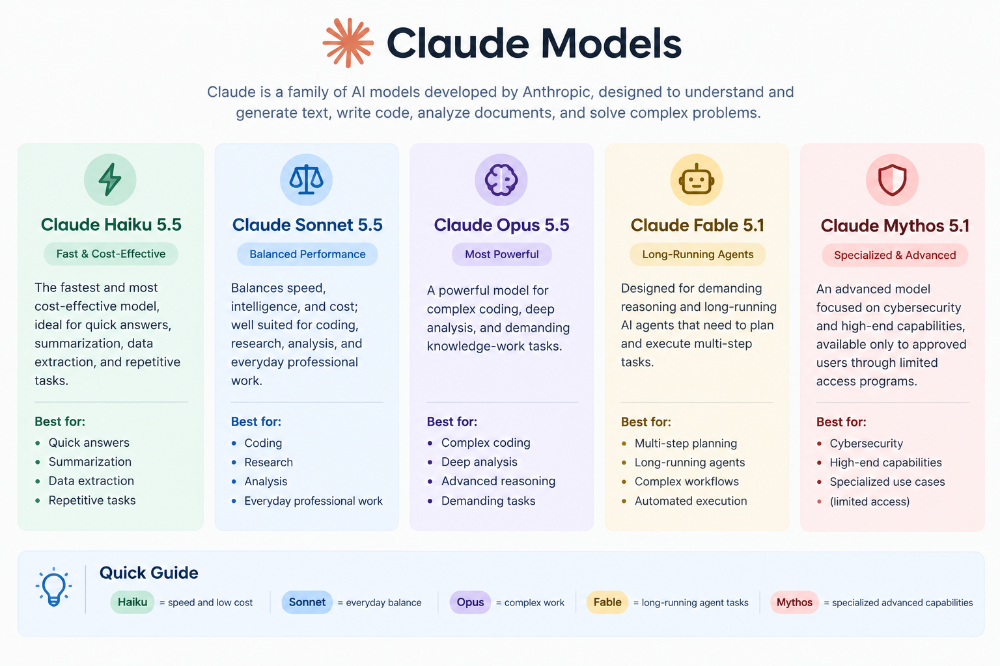

# NOTES for Claude Certified Architect - Foundations

- Large Language Models (LLMs) are AI systems trained to predict the next token in a sequence of the text. Tokens – LLMs break text into small units called tokens (words, parts of words, or characters) and process these tokens. Embeddings – Tokens are converted into numerical vectors that capture their meaning and relationships with other words. Transformer Architecture – Most modern LLMs are based on Transformers, which use attention mechanisms to understand relationships between different parts of the text. Training – The model learns patterns from large amounts of text by predicting the next token. Through training, it learns language structure, context, and relationships between concepts. Inference & Generation – When you give an LLM a prompt, it processes the input and generates a response token by token, using the patterns learned during training. Applications which are supported by LLMs - Chatbots, search systems and coding assistants ... etc

- LLMs do not generate knowledge. They just generate the most likely set of tokens. It generates what is likely to be true even if it isn't true. There are chances that LLMs might face halucinations. 

- Nobody trains LLMs from scratch now-a-days unless you are Facebook or Google or any other big gaint company. Everyone uses the pre-trained LLMs and fine-tune the model.

- The context window represents all the information available to the model while generating the response. Common context sources - System instructions, user messages, conversation history, Retrieved documents, Tool outputs. More context is not always better. Large contexts or Large prompts can increase latency, and may reduce the models ability to focus on important points. 

- We should know the Transformers architecture and the attention mechanism to understand the LLMs. All the LLMs use the transformer architecture. LLMs are probabilistic systems rather than deteministic systems. LLMs might not return the same result for the similar or same input. Few guidelines while prompting -
    - Clear instructions - Reduce ambiguity in the prompt to guide consistent outputs 
    - Structured Outputs - Enforce predictable response formats like json or excel. 
    - Validation and Retry loops - Correct unexpected responses
    - Human Review - high stake decisions must be reviewed by Humans 
    - Governance and safety  - Apply policy guardrails across the systems.

- Most AI applications are combinations of following - 
    - Prompts and instructions - Define the model's role , tone and task
    - Retrieval and knowledge - Supply relevant information at inference time
    - External tools - Extent the model with APIs and integration
    - Memory and Context - manage conversation history and state
    - Governance and monitoring - Ensure safety , compliance and observability. 
    - Modern AI systems combines LLMs with retrieval, tools, memory , monitoring and governance components.

- Uses Cases - 
    - Customer support resolution agent
    - Multi-Agent Research System
    - Claude Code Developer productivity
    - Structured Data Extraction System

- CCA-F teaches you the following - 
    -  underlying concepts of building agents
    -  exposes you to claude's models, coding tools and SDKs
    -  Focused on adoption of agentic workflows for orgs
    -  Fully understand MCP usage. 

- Claude Products - Claude is the product itself , Claude code & Claude Cowork
- Claude Features - Claude for chrome , Claude for Microsoft 365 & skills

- Claude chat -
    - Primarily a conversation and question-answering interface.
    - Best for research, explanations, brainstorming, writing, and analysis.
    - You give it an instruction and it generally responds with an answer.
    - Good for working with individual documents, images, data, and prompts.
    - You typically remain involved in the process and guide it step by step.
    - Think of it as: “Claude, help me understand/do this.”

- Claude Cowork - 
    - Designed to delegate an entire task or project to Claude.
    - Can work with multiple files, folders, documents, and data.
    - Better suited for research, data analysis, reports, presentations, and repetitive tasks.
    - Claude can break a task into multiple steps and execute them autonomously.
    - You give it the objective and review the finished output rather than directing every step.
    - Think of it as: “Claude, take care of this entire job for me.”

- Claude Code - 
    - Specifically designed for software development and programming.
    - Can inspect and understand an entire codebase/repository.
    - Can write, modify, debug, refactor, and test code.
    - Can use the terminal and development tools to run commands and tests.
    - Particularly useful for building features and fixing complex problems across multiple files.
    - Think of it as: “Claude, build/fix this application for me.”

- Claude Skills -
    - Claude Skills are reusable capabilities/instructions that teach Claude how to perform a specific type of task.
    - A Skill can contain instructions, workflows, templates, and supporting files.
    - For example, a Skill could teach Claude how to create financial reports, analyze Excel files, or follow a company-specific process.
    - Once a Skill is available, Claude can automatically use it when the task matches what the Skill is designed for.
    - Skills help make Claude’s work more consistent, structured, and specialized.
    - Think of Skills as “pre-packaged expertise/workflows that Claude can use when needed.”

- ChatGPT v/s Claude 
    - ChatGPT is good for everyday tasks and general tasks
    - Claude has more expertise than ChatGPT and provides more products, services & plugins.

- Features - 
    - Incognito mode for claude chat is provided. If I use incognito mode then the chat won't be saved. 
    - Claude Artifacts are like small apps which we can create while working with claude.

- Following are the claude custom instructions - 
    - For any task which I provide, please make sure that you ask me about the below things.

- Claude Custom Instructions -- AI sometimes becomes a people pleaser 
## Goal
## Context - Ask if any other context is required
## Action - What should be the course of action.
## Output - What should be the exact output format
Make sure that you ask me questions regarding the problem so we can tackle the whole task effectively.
Don't always or unnecessary agree with me, make sure that you present what exactly is best for the task in hand

- Claude Models - Claude divides the models into - Haiku, Sonet and Opus
    - Haiku - Fast , Simple Tasks, Low Cost , Gives quick answers
    - Sonet - Balanced, everyday task & Reasoning
    - Opus - Powerful , complex task, deep reasoning. Used for advanced problems

